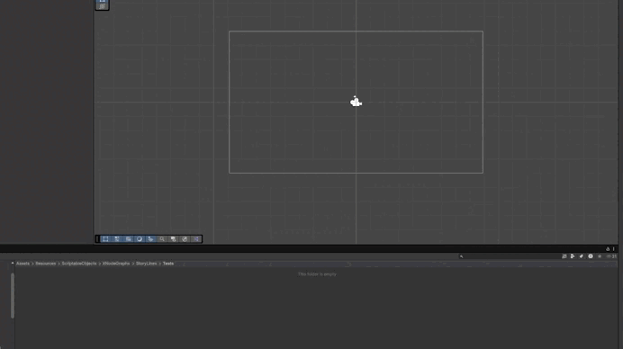
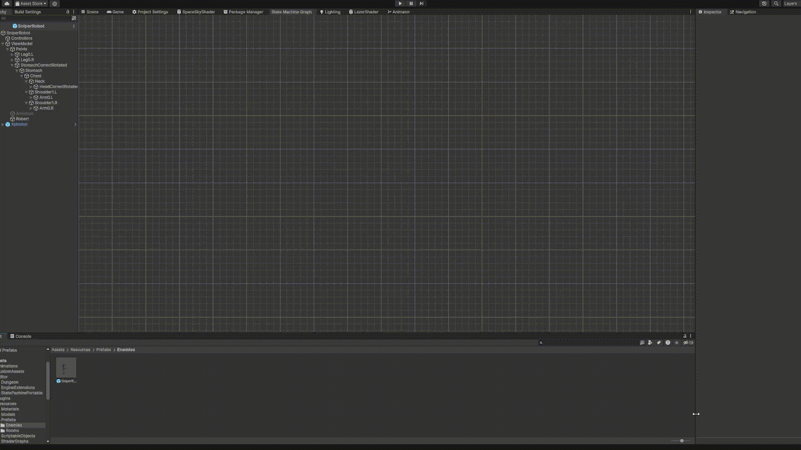

<div align="center">
  
  # 👾 Welcome to my Code Forge!
  
  <a href="https://github.com/DenverCoder1/readme-typing-svg">
    
  </a>

  <p>
    <em>Transforming coffee into performant C# code and building architectures that don't collapse on the first bug. ☕🚀</em><br>
  </p>

  <p>
    
    
    
  </p>
</div>

<br>

<div align="center">


# 🎮 Paper Tanks Mobile
**A mobile 2D turn‑based strategy game about tanks in a hand‑drawn style.**

[](https://unity.com/)
[]()
[]()


*Short gameplay showcase*

</div>

---

## 📖 About The Project

Paper Tanks Mobile is a game being developed as a personal project, which will later be refined as part of the semester program at SAE Institute. The main goal of the project is to adapt a school board game, wrapped in a more dynamic gameplay experience and featuring unique hand‑drawn artwork by Garfinkel.

At the moment, the project has reached the prototype stage and currently paused.

## 🛠 Tech Stack & Tools

* **Engine:** Unity 2021.3.2f1 LTS
* **Language:** C#
* **Architecture:** MVC, Component-Based Design
* **Dependency Injection:** simple scene/project-context injecting, using [Zenject by modesttree](https://github.com/modesttree/zenject)
* **Other Plugins/Tools:** DOTween, NaughtyAttributes

## 🏗 Architecture & Engineering Highlights

* **Turn-based system:** A turn-based gameplay based on State Machine has been created, along with basic algorithms for analyzing and searching for targets for enemies, with the addition of error margins.
* **Event-Driven Communication:** Replaced tight coupling with an Event Bus / ScriptableObject-based event system to handle UI and gameplay communication.
* **Sound system:** A simple but functional system for sound and music, controlled from the game menu.
* **Units & Grid:** The game field is represented as a mathematical grid that supports various types of units and objects, as well as a unit and object spawning system based on the Prototype pattern.

## Code examples links

* [Turn-base system](./project_examples/paper_tanks_mobile/code/turn_system.cs)
* [Enemies algorithms](./project_examples/paper_tanks_mobile/code/enemies.cs)
* [Grid](./project_examples/paper_tanks_mobile/code/grid.cs)
* [Units](./project_examples/paper_tanks_mobile/code/units.cs)

## Try it!

[📥 Download build (Windows) - alpha 2.0](https://github.com/RomanSobolev2004/Portfolio_RomanSobolev/raw/refs/heads/main/project_examples/paper_tanks_mobile/builds/PaperTanksMobile_Build.zip)


<div align="center">

 # 🎮 Mission In Space
**A 3D replayable first‑person shooter game**

[](https://unity.com/)
[]()
[]()


*Short gameplay showcase*

</div>

---

## 📖 About The Project

A study project within the framework of the second‑semester curriculum at SAE Institute. The key points and objectives of the project were to create an architecturally stable game and to implement a multithreaded system, as well as design patterns and Shader Graph. 

The project’s architecture was designed in accordance with the MVC and SOLID patterns, and multithreading was used to speed up the generation and placement of levels and objects. The StateMachine pattern, in the portable version, manages the basic AI of enemies, and the game itself is playable and replayable.

## 🛠 Tech Stack & Tools

* **Engine:** Unity 2023.2.20f1
* **Language:** C#
* **Architecture & Optimozation** MVC, SOLID, Component-Based Design, Multithreading
* **Dependency Injection:** simple scene/project-context injecting, using [Zenject by modesttree](https://github.com/modesttree/zenject)
* **Other Plugins/Tools:** DOTween, NaughtyAttributes, UniRX, Shader Graph, Portable StateMachine

## 🏗 Architecture & Engineering Highlights

* **Procedurale Generation:** Seamless procedural generation of the entire level, enemies, and quest items, optimized using multithreaded Jobs and employing mathematical calculations to determine the position of rooms.
* **Simple AI:** The universal and extended State Machine pattern, wrapped in a portable tool, allowed for quick and precise configuration of the enemy’s basic intelligence.
* **Shading:** Manually created simple shaders in Shader Graph to create the illusion of a beautiful environment and visual effects for items and weapons.
* **Event-Driven Communication:** Replaced tight coupling with an Event Bus / ScriptableObject-based event system to handle UI and gameplay communication.

## Code examples links

* [State Machine](./project_examples/mission_in_space/code/state_machine.cs)
* [Multithreading](./project_examples/mission_in_space/code/multithreading.cs)

## Try it!

[📥 Download build from GoogleDrive(Windows)](https://drive.google.com/file/d/16HdtxUpuX4q5OWaSrVdtYnmQ_kyLM7uA/view?usp=sharing)


<div align="center">

# 🎮 Ages of Tower Defence
**A Mobile 3D game in genre TowerDefence with a low poly graphics**

[](https://unity.com/)
[]()
[]()


*Short gameplay showcase*

</div>

---

## 📖 About The Project

My first project, brought to a certain point. The project was entirely my work, from the models to the code, which at that time had no distinctive features, since I was just starting to take development seriously at that point.

Nevertheless, the project includes 2 fully functional game levels, with some support for graphics settings music and sounds.

## 🛠 Tech Stack & Tools

* **Engine:** Unity 2021.3.2f1
* **Language:** C#
* **Architecture:** Component-Based Design, SPAGETTI

## Try it!

[📥 Download build (Windows)](https://github.com/RomanSobolev2004/Portfolio_RomanSobolev/raw/refs/heads/main/project_examples/ages_of_tower_defence/builds/AgesOfTowerDefence_Build.rar)
<!-- [📥 Download app (Android)](./project_examples/ages_of_tower_defence/builds/AgesOfTowerDefence_App.apk?raw=true) -->


<div align="center">

 # 🎮 The tale of the Lost one
**A 3D horror quest game**

[](https://unity.com/)
[]()
[]()


*Short gameplay showcase*

</div>

---

## 📖 About The Project

A study project within the framework of the second‑semester curriculum at SAE Institute. The key points and objectives of the project were to create an architecturally stable game and to implement a multithreaded system, as well as design patterns and Shader Graph. 

The project’s architecture was designed in accordance with the MVC and SOLID patterns, and multithreading was used to speed up the generation and placement of levels and objects. The StateMachine pattern, in the portable version, manages the basic AI of enemies, and the game itself is playable and replayable.

## 🛠 Tech Stack & Tools

* **Engine:** Unity 6000.0.59f2 LTS
* **Language:** C#
* **Architecture & Optimozation** MVC, SOLID, Component-Based Design
* **Dependency Injection:** Custom injection system, using [Zenject by modesttree](https://github.com/modesttree/zenject)
* **Other Plugins/Tools:** DOTween, NaughtyAttributes, UniRX, EasySave, Shader Graph

## 🏗 Architecture & Engineering Highlights

* **Custom injection system:** A specially created custom tool to bind and inject components at the required points in the code, without the need for hard‑coded arguments.
* **Custom save system:** The own save system for saving and loading key scene data, using the EasySave plugin
* **Event-Driven Communication:** Replaced tight coupling with an Event Bus / ScriptableObject-based event system to handle UI and gameplay communication.
* **Shading:** Manually created simple shaders in Shader Graph to create the illusion of a skybox and outdoors enviroment.
* **Visual atmosphere:** Custom assets for creating locations, and visual effects based on packages such as Linework (outline & filling) and VolumetricFog.
* **Flexible Enemy system:** The enemy spawning and control system, based on StateMachine, which makes it easy to create different variations of enemies with different logic.

## Code examples links

* [Object Wrapping tool, used for custom DI](./project_examples/tale_of_lost_one/code/wrapper.cs)

Example
```csharp
//Simple usage
private void Example()
{
    WrappedParameters parameters = new();
    parameters.WrappObjects(123, "Example", true);
    Debug.Log(parameters.Unwrapp<int>()); //returns 123 as int
    Debug.Log(parameters.Unwrapp<string>()); //returns "Example" as string

    parameters.WrappNew(321);
    Debug.Log(parameters.Unwrapp<int>(0)); //returns 123
    Debug.Log(parameters.Unwrapp<int>(1)); //returns 321

    parameters.WrappNew(m_player.WrappTo<IPlayer>());
    Debug.Log(parameters.Unwrapp<IPlayer>()); //returns m_player as IPlayer interface
}

//Binding Zenject
[Inject] IZenjectWrapped wrapped;
public override void InstallBindings()
{
    wrapped.Bind(player.Interface.WrappTo<IPlayer>());
}

//Injecting
[Inject]
protected virtual void Construct(IZenjectWrapped zenject)
{
    IPlayer parameter = zenject.Unwrapp<IPlayer>();
}
```
* [Save System](./project_examples/tale_of_lost_one/code/saves.cs)

Example
```csharp
public ClassExample: ISaveable
{
    private bool saved = false;
    private string save_string = string.Empty;

    public ClassExample()
    {
        SaveLoadRegistry.Register(this);
    }
    private void OnDestroy()
    {
        SaveLoadRegistry.Unregister(this);
    }
    
    public virtual ExpData PackData()
    {
        var data = new ThisObjecExpData();

        WriteData(data);

        return data;
    }

    protected virtual void WriteData(ThisObjecExpData data)
    {
       data.saved = saved;
       data.save_string = save_string;
    }
    public virtual void LoadData(ExpData data)
    {
        var objData = data as ThisObjecExpData;

        saved = objData.saved;
        save_string = objData.save_string;
    }
```
* [Enemy system](./project_examples/tale_of_lost_one/code/enemies.cs)

Creating new Enemy exapmle
```csharp
    public class NewEnemy_Bootstrapper: EnemyBootstrapper<NewEnemy_SpawnConitions_>
    {
        [SerializeField] private NavMeshAgent enemyNavMesh;

        [Space,Header("States")]
        [SerializeField] private ActiveState activeState;
        [SerializeField] private WalkState walkState;

        protected override void BindStates(IZenjectWrapped zenject)
        {
            base.BindStates(zenject);

            spawnConditions.BindCondition(zenject, new(EnableSave.WrappTo("IsSave")));

            activeState.BindState(zenject, new(enemyObject, enemyNavMesh, spawnConditions, EnableSave.WrappTo("IsSave")));
            walkState.BindState(zenject, new(enemyObject, enemyNavMesh, spawnConditions, EnableSave.WrappTo("IsSave")));
        }

        protected override void BindEnemyStateMachine(IZenjectWrapped zenject)
        {
            base.BindEnemyStateMachine(zenject);

            _enemyStateMachine.AddState(activeState, new StateTransition(walkState.GetType()));
            _enemyStateMachine.AddState(walkState);
        }
    }
```

* [Event based interacting system](./project_examples/tale_of_lost_one/code/interacting.cs)
* [Microphone- input from ingame enviroment noise](./project_examples/tale_of_lost_one/code/noise.cs)


## Try it!

[📥 Download build from GoogleDrive(Windows)](https://drive.google.com/file/d/1g_kOk_9yeFowEd9IawqHt-pqrPXCRMnm/view?usp=sharing)


<div align="center">

 # 🛠 VN Creator
**An in engine tool fore a create a Visual Novels**

[](https://unity.com/)
[]()
[]()



*Short tool usage demo*

</div>

---

## 📖 About The Project

This project is a tool for creating 2D visual novels, based on storing data in ScriptableObject and using the XNode plugin for convenient construction and customization of the required nodes, which can then be used in the engine.

 At the moment, the asset project is still under development and does not have a stable working demo version due to a large number of unfinished features; however, significant functionality is already present in the prototype form and is functioning in a promising way.

## 🛠 Tech Stack & Tools

* **Engine:** Unity 6000.2.11f1
* **Language:** C#
* **Architecture** MVC, SOLID, Component-Based Design
* **Dependency Injection:** simple scene/project-context injecting, using [Zenject by modesttree](https://github.com/modesttree/zenject)
* **Other Plugins/Tools:** XNode, DOTween, NaughtyAttributes, UniRX

## 🏗 Architecture & Engineering Highlights

* **Nodes based timeline:** The game progress is carried out using customized nodes from the XNode plugin. Each node is responsible for a specific action on the stage, stores the necessary information, and can be connected to other nodes.
* **Tiled game run processes:** This tool uses separate executor classes that independently perform the required action depending on which game flow node was passed and what data it has.
* **Event-Driven Communication:** Replaced tight coupling with an Event Bus / ScriptableObject-based event system to handle UI and gameplay communication.

## Code examples links

* [story graph node](./project_examples/vn_creator/code/node.cs)

Dialog Node Example
```csharp
public class DialogNode : StoryActionNode
{
    [field: SerializeField] public bool ShowMenue { get; private set; } = true;
    [field: SerializeField] public bool ShowBackgroundFill { get; private set; } = true;
    [field: SerializeField] public CharacterKeySO WhoSays { get; private set; }
    [field: SerializeField, TextArea(5, 20)] public string DialogLine { get; private set; }

    public override StoryActionTypes NodeType => StoryActionTypes.Dialog;
}
```
* [Game engine script](./project_examples/vn_creator/code/engine.cs)


<div align="center">

 # 🛠 Portable State Machine
**An Unity Editor tool for an easy use of State Mchine**

[](https://unity.com/)
[]()
[]()



*Short tool usage demo*

</div>

---

## 📖 About The Project

The project is a custom, manually created tool for wrapping Finite State Machine into a convenient and concise form in the form of a separate window, with custom nodes for each state and the ability to configure parameters and attach links to components/objects directly from the scene.

The project is under active development with the aim of releasing it to the public so that everyone can easily integrate such a useful pattern into their projects.

## 🛠 Tech Stack & Tools

* **Engine:** Unity 2023.2.20f1
* **Language:** C#
* **Architecture** MVC, SOLID, Component-Based Design
* **Other Plugins/Tools:** Unity Editor, NaughtyAttributes, UniRX

## 🏗 Architecture & Engineering Highlights

* **Custom editor graph window:** A graph written entirely by hand using the Unity Editor for configuring a state machine, which contains all the settings for a specific instance of the state machine and the current states in the form of nodes and the connections between them.
* **Nodes-states:** Each state can be wrapped in a special node. Such state nodes can be used in the graph, and they support all data types, including references to objects from the scene itself.
* **FSM:** The Finite State Machine design pattern is the core of the system, meaning it can be used both in a portable wrapper with a graph and without it.
* **Event-Driven Communication:** Replaced tight coupling with an Event Bus / ScriptableObject-based event system to handle UI and gameplay communication.

## Code examples links

* [Editor graph](./project_examples/portable_state_machine/code/graph.cs)
* [Portable state](./project_examples/portable_state_machine/code/node.cs)

Node example
```csharp
 public class WalkState : PortableState
    {
        [SerializeField] private Transform walkSubject;
        [SerializeField] private InterfaceReference<IEnemyNavMeshController> navMeshController;
        [SerializeField] private WalkingController walkingController;

        public override void Enter(params object[] args)
        {
            base.Enter(args);

            walkingController.StartWalk(walkSubject, navMeshController.Interface);
        }

        public override void Exit()
        {
            base.Exit();

            walkingController.StopWalk();
        }
    }
```
* [Portable FSM](./project_examples/portable_state_machine/code/fsm.cs)